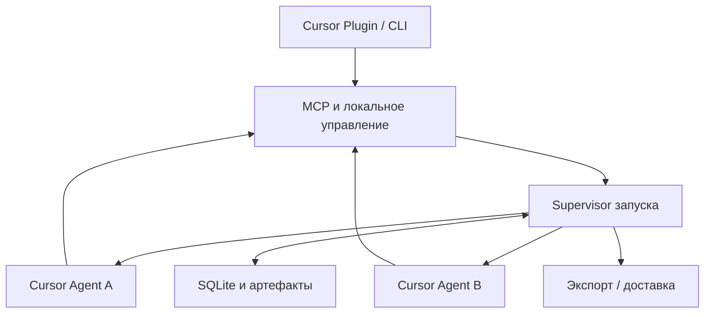

# CursorHive — структура, план реализации и аудит

Дата: 9 октября 2026 года. Редакция: 2, самостоятельный продукт.
Статус: архитектурный план. Локальный прототип 0.1 реализован; фактические возможности и неподтверждённые проверки перечислены в [docs/IMPLEMENTATION_STATUS.md](docs/IMPLEMENTATION_STATUS.md).

Репозиторий: [daMpoff/ergoms_cursor_hive](https://github.com/daMpoff/ergoms_cursor_hive).
Название продукта: **CursorHive**. Имена Python-пакета, CLI и плагина: `cursor_hive_runtime`, `cursor-hive`, `cursor-hive`.

## 1. Принятое решение

CursorHive — самостоятельный локальный инструмент для совместной работы двух Cursor Agent над одним результатом. Он состоит из движка и плагина Cursor. Пользователь задаёт работу из чата или CLI, исполнители используют отдельные рабочие копии, общую очередь и публикации промежуточных результатов.

ERGO MS — возможная будущая интеграция. Установка, запуск, тесты, хранение состояния и выпуск CursorHive не зависят от него. Название существующего GitHub-репозитория можно сохранить без переименования.

| Входит в продукт | Ответственность |
| --- | --- |
| Локальный runtime | Состояние запуска, очередь, процессы, рабочие копии, публикации, проверки и восстановление |
| Cursor Plugin | Команды/skill, инструкции и MCP к runtime |
| CLI | Проверка установки, запуск, статус, уточнение, остановка и экспорт восстановления |
| Будущее расширение VSIX | Панель состояния и просмотр изменений через тот же локальный протокол |

Из обязательного состава исключены Django, DRF, Vue, PostgreSQL, Redis, Celery, ModuleBridge, platform media API, серверные пользователи и схемы модулей. Каталоги `api/`, `client/`, модульный `mcp/manifest.yaml` и файлы ERGO MS lifecycle/discovery не создаются.

## 2. Итог архитектурного аудита

Аудит охватывает актуальный план, опубликованную архитектуру DeLM и первичную документацию Cursor. Это аудит проекта решения, а не проверка работающего кода. «Исправлено в плане» означает наличие определённого контракта; его выполнение ещё нужно доказать реализацией.

| ID | Приоритет | Обнаруженная проблема | Решение и статус |
| --- | --- | --- | --- |
| A01 | Высокий | Обязательный модуль увеличивал объём и связывал локальный продукт с платформой | Зависимости и серверный этап исключены; исправлено в плане |
| A02 | Блокер прототипа | Одна команда `agent -p` не определяла режим фактического редактирования | Профиль прав и проба записи обязательны; остаётся проверить на установленном CLI |
| A03 | Высокий | Плагин IDE трактовался как возможное полное наследование текущего чата | Передаём явный запрос; не обещаем native fork и полную копию живой сессии |
| A04 | Блокер прототипа | Не был доказан MCP в двух CLI-сессиях | Отдельная проба на каждую рабочую копию и principal; остаётся проверить |
| A05 | Высокий | Одновременный старт с одинаковым запросом мог дать две полные дублирующие реализации | Короткая начальная передача задач первым исполнителем; затем равноправная работа |
| A06 | Высокий | Повтор команды и загрузка плагина в worker могли запустить новые пары агентов | Идемпотентный старт, блокировка проекта, отдельные права worker и запрет вложенного запуска |
| A07 | Высокий | Жизненный цикл runtime мог зависеть от MCP-подключения чата | Отдельный supervisor запуска; MCP — короткоживущий прокси |
| A08 | Высокий | Ожидание могло держать модель или потерять событие между ходами | Регистрация ожидания, завершение хода, повторная проверка и однократное пробуждение |
| A09 | Высокий | Snapshot не имел правила согласованности при записи пользователем | Манифест, повторное сравнение и отказ от нестабильного capture |
| A10 | Высокий | Проверка файла перед доставкой не устраняет гонку с редактором | Консервативная доставка с журналом; строгий режим экспорта до проверки файлового backend |
| A11 | Высокий | Выход CLI и текст «тесты прошли» могли смешиваться с результатом тестовой команды | Receipt только из наблюдённого исполнения; иначе отдельная проверка runtime |
| A12 | Высокий | Lease/PID сами по себе могли разрешить опасное переназначение или остановку | Версии claim, подтверждение остановки, PID + время создания + принадлежность |
| A13 | Средний | Независимые копии могут лишиться зависимостей и входных данных | Явный план окружения, список исключений и состояния blocked |
| A14 | Средний | «Самодостаточный плагин» не объяснял доставку Python-зависимостей | Версионированные wheels и управляемое окружение; без ссылок на checkout |
| A15 | Средний | Этапы и проверки продолжали требовать ERGO MS | Переписаны вокруг локального MVP и сценариев пользователя |
| A16 | Средний | Скорость/стоимость и статус готовности могли быть завышены | Сопоставимый baseline, неизвестные метрики отмечаются; готовность подтверждается отдельно |

**Вывод:** самостоятельная архитектура подходит для прототипа. Реализуемость интеграции с Cursor пока условна: старт реальных двух агентов допускается после проверки прав, MCP, продолжения сессий и остановки. Полную эквивалентность нативному плагину авторов пока заявлять нельзя.

## 3. Что воспроизводим из DeLM

Научная статья и продуктовый плагин авторов решают близкие, но разные задачи. В экспериментальном протоколе агент готовит собственное полное решение [S1]. Продуктовый DeLM объединяет работу двух исполнителей в один результат [S2]. CursorHive выбирает продуктовый вариант.

| Механизм | Контракт CursorHive |
| --- | --- |
| Общая очередь | Одна активная задача у исполнителя, атомарное владение |
| Общий контекст | Неизменяемые находки, ошибки, исправления и завершения |
| Компактное чтение | Новые записи по курсору; содержимое файлов отдельно |
| Независимая работа | Две копии общего сохранённого baseline |
| Переиспользование | Неизменяемые артефакты и импорт с проверкой конфликтов |
| Интеграция | Временный владелец сборки результата, максимум один |
| Доказательства | Проверки с происхождением и областью применимости |
| Доставка | Один выбранный результат, журнал и восстановление |

Runtime управляет состоянием и процессами. Он не является постоянным LLM-планировщиком. Начальный исполнитель подготавливает доступную работу для второго, но после запуска не получает особых полномочий.

Из источников авторов можно заимствовать подходы и применимые алгоритмы. Код native adapters Codex/Claude требует собственной адаптации; переименование хоста не создаёт Cursor-интеграцию. При переносе файлов сохраняются MIT-уведомления и исходный commit [S3].

## 4. Границы первого продукта

Первый поддерживаемый сценарий: локальный Git-проект, сохранённые текстовые исходники, два агента одной выбранной модели, одно задание, один итог. Существующие staged, unstaged и допущенные untracked файлы входят в baseline.

Ограничения MVP:

- несохранённые буферы IDE в baseline не входят; это показывается при запуске;
- submodule, Git LFS, внешние symlink и нестандартные файловые типы требуют отдельной поддержки; до неё выдаётся отказ или экспорт;
- бинарные результаты и переходы файл/каталог экспортируются, автоматическое применение не обещается;
- трудоёмкие установки и проверки имеют собственные таймауты;
- нет обязательного reviewer-агента, RAG, Ollama или облачного сервера;
- закрытие чата не уничтожает работу; остановка выполняется явной командой;
- постоянного сервиса на всю машину нет: supervisor создаётся для конкретного запуска.

На Windows используем Python 3.12 и отдельно квалифицируем native Cursor CLI. Документация описывает нативную установку Windows и WSL [S9]. Поддержка установки Cursor не доказывает корректность нашего supervisor. Linux/macOS — отдельные строки матрицы совместимости.

## 5. Cursor: подтверждённые возможности и проверки

### 5.1. Упаковка

Выбираем Cursor Plugin с `.cursor-plugin/plugin.json`, командами, skill и MCP [S4]. VSIX не требуется для первого запуска из чата.

Сборка плагина находится в `dist/cursor-hive/`. Все ресурсные пути внутри пакета относительные; нет `../..` к исходному репозиторию. MCP использует `${CURSOR_PLUGIN_ROOT}`; стандартные `${PLUGIN_ROOT}` и `${PLUGIN_DATA}` не подставляются Cursor [S5].

### 5.2. Исполнение

Основной кандидат — headless CLI с `-p --output-format stream-json`. Нужны реальные события и сохранённый session_id; продолжение привязывается к конкретной сессии, а не к «последнему чату» [S7, S10].

В документации есть расхождение формулировок: headless-страница связывает непосредственную запись с `--force`, страница using говорит о write access в non-interactive mode, а permissions описывает allow/deny [S6, S7, S8]. Поэтому нельзя выбрать права по одному примеру.

Doctor проверяет фактическую запись разрешённого файла, отказ запрещённой операции и отсутствие зависшего запроса разрешения. Профиль запуска фиксируется в отчёте. `--force` не добавляется скрыто: режим автоматизации с ним проверяется отдельно и включается только как явно выбранная конфигурация. Работа без `--force` допустима лишь после подтверждённой пробы.

Project permissions не получают автоматически пустой `deny`: поддержка Cursor объясняет, что project-блок заменяет глобальные списки [S12]. Эффективные ограничения собираются и проверяются явно. Исходный глобальный конфиг не перезаписывается.

ACP оставляем будущим адаптером: документация описывает сессии и project/user MCP [S11], но 28.09.2026 поддержка подтвердила проблемы plugin loading и lifecycle hooks [S12]. Проверка актуальной версии может изменить выбор транспорта.

### 5.3. Что не обещаем

Две CLI-сессии не являются доказанными native forks текущего чата IDE. Runtime передаёт сохранённый текст задания, допущенные инструкции и выбранную конфигурацию. История, активные подключения и live overrides автоматически не клонируются.

Запрос, полученный через MCP от модели, помечается `request_source=mcp_supplied`; он не выдаётся за перехваченный оригинальный prompt. Если требование точного перехвата станет обязательным, нужен проверенный native hook/adapter. В первом интерфейсе переданный текст отображается в статусе запуска.

### 5.4. Capability report

| Проверка | Что должно быть доказано |
| --- | --- |
| Версии | OS, Python, Cursor IDE/CLI, путь executable, версия runtime |
| Streaming | Разбор NDJSON, init/result, ошибка и неожиданный конец потока |
| Запись | Реальное изменение разрешённого файла и проверка deny |
| MCP | Успешный инструмент в каждой копии с различимой привязкой |
| Продолжение | Нужный session_id, сохранённый контекст, восстановленный MCP |
| Отмена | Остановка хода и учёт дочерних процессов |
| Плагин | Загрузка команд/skill/MCP в IDE; CLI проверяется отдельно |
| Пути | Пробелы, кириллица, регистр, длинный путь |
| Окружение | Минимальная проверка проекта в рабочей копии |

Инвентарь инструментов нельзя выдумывать из init-события: документация называет часть полей потенциальными будущими добавлениями [S10]. Используем реальный probe, а неизвестные сведения отмечаем.

Обычный `cursor-hive doctor` проверяет локальные prerequisites без вызова модели. Предлагаемый `doctor --live` явно запускает ограниченные host probes; они используют Cursor и могут расходовать квоту. Эти CLI-команды ещё не реализованы.

## 6. Архитектура и стек

Все изменения очереди проходят через один runtime. MCP-прокси не открывают собственную независимую очередь. Будущий VSIX использует тот же протокол.

| Область | Начальный выбор |
| --- | --- |
| Runtime | Python 3.12, asyncio, subprocess |
| Состояние | sqlite3, локальная WAL-база каждого запуска |
| MCP | Python MCP SDK с закреплённой версией |
| Локальный transport | Авторизованный loopback RPC; stdio со стороны Cursor |
| Данные | Версионированные DTO, JSON Schema/строгая валидация |
| Установка | Wheels и отдельное управляемое Python-окружение |
| Проверки | pytest и fake-agent процессы |
| VSIX позже | TypeScript, тонкий клиент runtime |

Python выбран ради простого локального прототипа, стандартной SQLite и удобства сопровождения на целевой Windows. Это проектное решение, а не требование DeLM. Смена языка не входит в первый этап.

SQLite WAL допускает несколько читателей, но одного writer одновременно; БД размещается на локальном диске [S13]. Транзакции короткие; копирование файлов, модель и внешние команды идут вне транзакции. Конкурентное владение защищается условиями SQL и версией [S14].

## 7. Структура репозитория

Создаём каталоги по мере появления рабочей реализации. Весь список ниже — целевая структура, а не поручение заранее заполнить десятки заглушек.

### 7.1. Корень

| Путь | Назначение |
| --- | --- |
| `README.md` | Установка и проверяемый первый запуск |
| `AGENTS.md` | Правила разработки самостоятельного проекта |
| `BEHAVIOR.md` | Согласованное поведение продукта |
| `CURSOR_HIVE_STRUCTURE.md` | Этот план и аудит |
| `pyproject.toml` | Runtime, CLI entry points и dev-зависимости |
| `requirements.lock` | Проверенные точные зависимости установки |
| `LICENSE`, `THIRD_PARTY_NOTICES.md` | Лицензия продукта и перенесённого кода |
| `docs/protocol.md` | DTO, версии, права и ошибки |
| `docs/cursor-compatibility.md` | Фактическая матрица проверок Cursor |
| `docs/recovery.md` | Остановка, конфликт и восстановление |
| `docs/decisions/` | Краткие записи принятых технических решений |
| `.github/workflows/` | Проверки и сборка поддерживаемых платформ |

### 7.2. Runtime: `src/cursor_hive_runtime/`

| Путь | Ответственность |
| --- | --- |
| `cli.py`, `config.py` | CLI, конфиг и лимиты |
| `doctor.py` | Host probes и capability report |
| `protocol.py`, `domain.py` | Версионированные сообщения и состояния |
| `supervisor.py` | Запуск, продолжение, ожидание и остановка |
| `control/server.py`, `control/client.py` | Локальный RPC |
| `control/auth.py`, `control/locks.py` | Principals, scope, блокировки |
| `board/store.py`, `board/migrations/` | SQLite и миграции |
| `board/tasks.py` | Создание/claim/release/complete |
| `board/context.py` | Публикации и чтение событий |
| `board/artifacts.py` | Неизменяемые объекты и манифесты |
| `board/checks.py` | Происхождение и применимость receipts |
| `adapters/base.py` | Контракт хоста |
| `adapters/cursor_headless.py` | CLI, streaming и session_id |
| `lifecycle/processes.py` | Принадлежность процессного дерева |
| `lifecycle/revisions.py`, `lifecycle/recovery.py` | Уточнения и восстановление |
| `workspace/capture.py`, `workspace/prepare.py` | Baseline и копии |
| `workspace/imports.py` | Применение публикаций |
| `workspace/candidate.py` | Фиксация выбранного результата |
| `workspace/delivery.py`, `workspace/journal.py` | Доставка и восстановление |
| `verification/executor.py` | Проверки выбранного snapshot |
| `mcp/server.py`, `mcp/bindings.py` | Stdio-прокси и привязка прав |
| `report.py`, `metrics.py` | Итог и доступные измерения |

### 7.3. Плагин: `hosts/cursor/`

| Путь | Назначение |
| --- | --- |
| `.cursor-plugin/plugin.json` | Manifest `cursor-hive` |
| `mcp.json` | MCP контроллера |
| `commands/hive-run.md` | Начать работу |
| `commands/hive-status.md` | Получить статус |
| `commands/hive-update.md` | Передать уточнение |
| `commands/hive-stop.md` | Остановить и сохранить |
| `commands/hive-recover.md` | Экспортировать сохранённое |
| `skills/run/SKILL.md` | Работа пользователя с запуском |
| `worker-policy.md` | Общая инструкция исполнителям |
| `bin/` | Launcher поддерживаемой ОС |
| `hooks/` | Добавляется только после проверки событий |
| `runtime/` | Wheels, manifest и ресурсы собранного пакета |

Команды — целевые имена. Отображение namespace проверяется при установке. Worker получает рабочие инструменты, а не права контроллера. Совместная политика действует только внутри Hive-запуска; её нельзя сделать глобальной инструкцией для каждого обычного чата.

### 7.4. Сборка и проверки

| Путь | Назначение |
| --- | --- |
| `scripts/build_plugin.py` | Сборка `dist/cursor-hive/` |
| `scripts/install_plugin.py` | Установка и проверка launcher |
| `tests/unit/` | Транзакции и переходы состояний |
| `tests/integration/` | IPC, процессы, файлы и recovery |
| `tests/fixtures/fake_agent/` | Два управляемых процесса без LLM |
| `tests/live/` | Небольшие явные проверки Cursor |
| `extensions/cursor-hive/` | VSIX на последующем этапе |
| `integrations/` | Возникает лишь при реализации внешнего адаптера |

ACP, внешние адаптеры и UI не добавляются как пустые обязательные подсистемы MVP.

## 8. Хранение и локальное управление

Данные находятся в пользовательском каталоге приложения, вне исходного проекта и каталога установленного плагина. Базовый путь выбирается по ОС, допускается переопределение на локальный диск.

| Объект | Содержимое |
| --- | --- |
| `config.json` | Выбранный executable, профиль и лимиты |
| `runs/<run_id>/state.sqlite` | Очередь, журнал событий и операции |
| `runs/<run_id>/baseline/` | Сохранённые исходные файлы |
| `runs/<run_id>/workers/a/`, `workers/b/` | Независимые рабочие деревья |
| `runs/<run_id>/objects/` | Неизменяемые байты по хэшу |
| `runs/<run_id>/recovery/` | Манифесты и сохранённые displaced entries |
| `runs/<run_id>/report.json`, `report.md` | Машинный и пользовательский итог |
| `locks/` | Локальные блокировки проектов |

Supervisor поднимает endpoint только на loopback. Каждое подключение аутентифицируется случайным credential с правами controller либо конкретного worker. Credential хранится вне промпта и отчёта; не передаётся секретом в командной строке. OS-права защищают файлы состояния.

Worker binding ограничен run_id, worker_id и generation. В дочернюю среду передаётся только worker credential. Даже launcher глобально установленного плагина выбирает этот binding; при его ошибке нет fallback к controller credential. Native permissions проверяет Cursor перед MCP-вызовом; host probe должен подтвердить это для выбранного профиля. Прокси не реконструирует approvals из JSON. Локальная авторизация runtime не заменяет одобрение хоста и не доказывает соответствие native approval tickets DeLM.

Сборка, MCP и supervisor согласуют `protocol_version`. Несовместимые версии отказывают в изменениях. Перезапуск MCP не уничтожает supervisor. Crash supervisor сохраняет БД; новый процесс не присваивает старые workers до проверки владельца и process identity.

Это инструмент доверенной локальной разработки. Раздельные директории и credentials координируют агентов, но не изолируют вредоносный процесс с правами того же OS-пользователя. Сильная sandbox-изоляция — отдельная функция.

## 9. Данные и инварианты

| Сущность | Основные поля |
| --- | --- |
| Run | UUID, project identity, request text/source/revision, state, limits, baseline |
| Worker | UUID, session_id, workspace, principal, process identity, acknowledged_revision |
| Turn | UUID, worker, generation, revision, state, result/exit |
| Task | UUID, request_revision, dependencies, owner, claim_version, state, lease_until |
| Publication | UUID, sequence, type, scope, evidence, references, author, revision |
| Artifact | UUID, publication, manifest, hashes и object references |
| CheckReceipt | command identity, outcome, inputs, environment, observer, revision |
| Candidate | UUID, revision, contract, snapshot и receipts |
| Operation | principal, operation_id, arguments_digest, сохранённый ответ |
| Event | sequence, UUID, type, payload |
| DeliveryEntry | path, before/after hashes, backup reference, phase |

Обязательные инварианты:

1. Один незавершённый Hive-запуск на нормализованный корень проекта. Алиасы пути не обходят блокировку.
2. Не более одной активной задачи у worker и одного integration claim на запуск.
3. Claim меняется атомарно; `complete` проверяет владельца, claim_version и revision.
4. Mutation и Event записываются в одной транзакции.
5. Повтор `operation_id` с теми же аргументами возвращает прежний ответ; с другими — ошибку.
6. Publication и bytes артефакта после публикации не меняются.
7. Runtime не завершает новую revision старым candidate.
8. Cleanup не удаляет единственную сохранённую копию результата.

Блокировка проекта сохраняется при failed/recovery_required, если остановка writers или сохранение результата не подтверждены. Терминальный статус сам по себе не снимает блокировку.

Зависимости задач ссылаются на task UUID; артефакты/доказательства — на publication UUID. Самоссылки и циклы отклоняются. После уточнения неприменимые задачи отменяются/заменяются явно, а применимые получают подтверждённую revision. Автоматически переписывать смысл задач runtime не должен.

## 10. MCP-контракты

Имена ниже — проект протокола. Mutation принимает operation_id и ожидаемую версию состояния. Agent identity и права назначает подключение, модель не передаёт произвольный owner.

| Инструмент | Права | Назначение |
| --- | --- | --- |
| `hive_run_start` | controller | Быстро резервирует запуск, возвращает run_id/state |
| `hive_run_status` | controller | Состояние, ограничения, события и результат |
| `hive_run_update` | controller | Сохраняет новую revision |
| `hive_run_stop` | controller | Запрашивает остановку и сохранение |
| `hive_recover_export` | controller | Экспорт выбранной сохранённой дельты |
| `hive_task_create` | worker | Создаёт работу с ожидаемым выходом |
| `hive_task_claim` | worker | Атомарно занимает доступную задачу |
| `hive_task_release` | worker | Освобождает собственный claim |
| `hive_task_complete` | worker | Закрывает актуальный claim с publication |
| `hive_context_read` | worker | Компактные новые события и курсор |
| `hive_context_publish` | worker | Находка, fail, correction или completion |
| `hive_request_ack` | worker | Подтверждает полученную revision текущего хода |
| `hive_artifact_expand` | worker | Выбранный diff/файлы без изменения дерева |
| `hive_artifact_apply` | worker | Применение в собственной копии или конфликт |
| `hive_worker_yield` | worker | Регистрирует ожидание и возвращает указание завершить ход |
| `hive_integration_claim` | worker | Временное владение сборкой результата |
| `hive_candidate_submit` | integration owner | Фиксирует итоговый snapshot и учёт требований |
| `hive_check_request` | worker | Заказывает проверку snapshot из разрешённого профиля |

`hive_check_request` возвращает check_id быстро; исполнение и статус идут отдельно. Модель не создаёт валидный receipt произвольным текстом. Произвольный shell endpoint не нужен: профиль проверки имеет заданные argv, cwd, timeout и входы.

Состояния queued/running/completed/failed для check_id публикуются в Event и читаются через hive_context_read. Worker mutations привязаны к актуальному turn generation и подтверждённой revision. Запоздалый результат может сохраниться как историческая публикация, но не закрывает текущую задачу.

Передача файлов проверяет относительные нормализованные пути, выход через symlink, регистр/коллизии Windows и разрешённый корень. Лимиты размера и пагинация обязательны. Ответ чтения включает sequence, totals, has_more и continuation; изменение фильтра не переиспользует чужой курсор.

## 11. Старт и совместная работа

1. Controller фиксирует текст запроса и профиль. `start` получает operation_id, блокировку проекта и run_id.
2. Supervisor выполняет preflight, capture и prepare. Ошибка оставляет объяснение; статус `starting` не означает, что агенты уже работают.
3. Передаёт первому worker общий запрос и политику. Тот занимает полезную работу и создаёт доступную взаимодополняющую задачу.
4. Второй worker стартует после появления такой задачи. Начальная передача ограничена таймаутом; отсутствие handoff даёт ошибку `bootstrap_stalled`, без скрытого запуска второго полного решения.
5. Далее агенты равноправны: выбирают доступную работу, публикуют изменения, читают новое перед сменой гипотезы и импортируют пригодные артефакты.
6. Worker без доступной работы регистрирует ожидание и завершает ход. Supervisor продолжает ту же сессию после полезного события.
7. Любой worker может взять integration claim и собрать один результат из совместимых публикаций.
8. Candidate фиксируется неизменяемо, привязан к revision и контракту требований. Он содержит snapshot всех допущенных входов для проверки и отдельный список доставляемых изменений/запрошенных артефактов. Явный пустой список результатов-артефактов отличается от отсутствующего учёта таких требований.
9. Runtime закрывает приём финализации, останавливает принадлежащие workers и повторно проверяет candidate/receipts.
10. Выполняется экспорт либо квалифицированная доставка. Отчёт показывает точный исход.

Parent-чат сопровождает запуск и передаёт уточнения. Его policy не поручает параллельно менять те же исходные файлы. При внешних изменениях работают проверки конфликта, а не предположение об эксклюзивном доступе пользователя.

Worker-principal не может вызвать `run_start`. Если глобально установленный плагин виден worker, runtime всё равно отклоняет controller mutation. Launcher и hooks проверяют worker marker. Одной текстовой просьбы «не запускай Hive снова» недостаточно.

## 12. Состояния, ожидание и уточнения

| Уровень | Основные состояния |
| --- | --- |
| Run | starting, running, blocked, finishing, delivered, exported, stopping, cancelled, failed, recovery_required |
| Worker | starting, active, waiting, idle, stopped, failed |
| Task | available, claimed, blocked, completed, cancelled |
| Turn | starting, active, yielded, completed, cancelled, failed |

Выход CLI с кодом 0 означает завершение хода, а не готовность всего задания. Неожиданный конец NDJSON, non-zero exit и завершение после yield различаются [S10].

**Ожидание:** runtime сохраняет интересующие условия и sequence при yield. После выхода хода проверяет очередь снова. Событие, случившееся между yield и выходом, не теряется. Worker generation и transition lock запрещают два одновременных resume. Активный shell sleep не используется для ожидания peer.

**Уточнение:** новый текст сохраняется как revision и передаётся обоим существующим workers. Подтверждение даётся после наблюдаемой передачи текста в соответствующий ход и hive_request_ack от worker, а не после записи в inbox. Если CLI не поддерживает безопасную вставку в текущий ход, runtime отменяет/заканчивает ход и продолжает session_id. Непроверенная resume-возможность блокирует этот режим. blocked сохраняет причину и предыдущую фазу, чтобы допустимое уточнение или подготовка окружения могли продолжить работу.

Перед `finishing` runtime атомарно закрывает update admission. Уже принятую новую revision учитывает; более позднее update получает явный конфликт состояния, не молчаливый успех. Worker generation и finalization generation не допускают старую финализацию.

Lease служит диагностике. Истечение само по себе не отдаёт задачу другому живому writer. Сначала подтверждается остановка старого владельца, затем повышается claim_version. Неопределённость сохраняет workspace и переводит запуск в recovery_required.

## 13. Baseline и окружение

Git worktree переносит committed состояние, но не всё текущее dirty tree. Для MVP делаем обычные независимые копии admitted baseline с собственной Git-администрацией. Исходная `.git`, index и настройки репозитория не изменяются.

Capture строит полный манифест допущенных путей, типов и хэшей; сохраняет байты в object storage; повторяет перечисление и сравнение. Изменение файла, состава путей или index во время capture приводит к повтору/отказу. Это проверка стабильности, а не обещание атомарного snapshot при произвольном внешнем writer.

Untracked учитываются по явной политике. Ignored не копируются целиком: нужные входы включаются отдельно, секреты и среды исключаются с отчётом. Контроллер запрашивает недостающий вход, если без него задача невыполнима.

Копии не получают автоматически `.venv`, `node_modules`, account storage и секреты. Фиксируется environment plan: interpreter/toolchain, lock files, требуемая установка и test profile. Тяжёлые зависимости можно подготовить заранее; сериализация установок — механизм runtime, а не новая LLM-роль.

Если проект требует БД, сервис или закрытые данные, состояние показывается как blocked с причиной. Успешное копирование файлов не считается рабочим окружением. Операционные файлы Hive в worker исключаются из публикуемой дельты.

## 14. Публикации и импорт

Publication хранит тип `fact`, `fail`, `correction` или `completion`, область, доказательства, ссылку на задачу и revision. Исправление ссылается на предыдущую запись. История не редактируется.

Артефакт содержит замороженные bytes и манифест base/published hash для каждого пути. Последующие изменения автора не меняют публикацию. Ошибку можно закрыть correction с доказательством; сам факт сообщения агента не доказывает исправление.

В MVP импорт применяется только при совместимом base. Отличающийся текущий файл возвращает конфликт; трёхсторонний merge добавляется позже. Для связанных файлов сначала проверяется весь набор, затем журналируется применение; после сбоя восстановление не объявляет частичное применение успешным.

Completed Task означает выполненный ожидаемый выход, но не завершение всего пользовательского запроса. Integration owner учитывает исходные требования и открытые относящиеся fail независимо от числа закрытых задач.

## 15. Проверки и готовность

Receipt принимается из реально наблюдённого исполнения. Terminal result всего Cursor-хода не даёт exit code тестовой команды. Набор полей stream-json квалифицируется на конкретной версии; отсутствующие сведения не восстанавливаются из текста агента.

Начальный надёжный backend — runtime executor над отдельным неизменяемым snapshot candidate. Он записывает argv, cwd, timeout, исход, входные hashes и идентификатор окружения. Проверка worker может быть переиспользована лишь при доказанном происхождении и применимости.

Во время проверки snapshot не редактируют агенты. Изменяемые сгенерированные outputs отделяются от входов. Хэши inputs проверяются до/после; изменение входов самой тестовой командой делает receipt неприменимым. Это не исключает скрытую временную запись с последующим восстановлением bytes. Зависимости вне scope и внешние сервисы перечисляются как ограничения; receipt не доказывает полноту покрытия.

| Итог | Значение |
| --- | --- |
| delivered | Поддержанные изменения перенесены без выявленного конфликта |
| exported | Дельта и манифест сохранены отдельно; исходный проект не применён |
| verification_required | Перенос/окружение требуют проверки на исходной машине |
| ready | Требования учтены, применимые проверки выполнены и итоговое окружение проверено |
| recovery_required | Есть сохранённая работа, но остановка или доставка не подтверждены |

`ready` — признак отчёта, не синоним любого терминального Run state. Если нужны проверки в оригинальном проекте, они выполняются контроллером по заданному профилю после доставки. Для отсутствующей в проекте проверки явно описывается ручная верификация; runtime не выдаёт её за автоматический receipt.

## 16. Доставка и восстановление

Сначала реализуется `export`: выбранная дельта, base/result hashes, отчёт и инструкции в новом каталоге. Это первый проверяемый результат без риска частично применённого дерева.

Затем добавляется `guarded_apply` для ограниченного класса обычных текстовых файлов. Сравниваются baseline, candidate и текущие исходные bytes; прежний Git index остаётся неизменным. Пользовательские изменения в том же файле дают конфликт; unrelated изменения сохраняются.

Простой алгоритм «сравнили hash, затем replace» имеет TOCTOU-гонку и недостаточен для строгой гарантии. До квалификации OS-backend режим с такой гарантией остаётся export. Apply требует:

- preflight всего выбранного набора и журнал до первого изменения;
- сохранения заменённых entries и проверки их изменения через старые открытые descriptors;
- повторной проверки путей/типов перед операцией и итоговых bytes;
- явного состояния частичной доставки после сбоя;
- сохранения последующих пользовательских правок при восстановлении.

Многофайловая доставка не является глобальной транзакцией редактора. Несовместимые операции экспортируются. Автоматических reset --hard, clean -fd или force push в доставке нет.

Восстановление по умолчанию экспортирует blobs и before/after manifests в новый каталог. Повторный recover идемпотентен по выбранному результату; существующий чужой каталог не затирается. Delete/symlink/metadata в export описываются манифестом, а не исполняются автоматически.

Очистка временных копий разрешена после подтверждённой остановки и проверенного сохранения результата/recovery bundle. При сомнении сохраняем дерево. Тяжёлые baseline/workspaces и небольшой отчёт имеют разные сроки хранения; credentials и runtime environment не включаются в диагностический экспорт.

## 17. Принадлежность процессов и лимиты

Runtime записывает PID, время создания, run/worker generation и собственные handles/process group. Совпадение cwd или один старый PID не даёт права завершить процесс.

Windows process backend квалифицируется отдельно: включая дочерний shell, зависший turn и переиспользование PID. POSIX group/signal backend тоже требует проверки descendants. Незарегистрированные внешние writers не считаются принадлежащими Hive.

Лимиты: deadline запуска, длительность хода/проверки, число повторных resume/retry, объём snapshot/publications/logs и свободное место. Модельный бюджет применяется только при наличии реальных сведений о usage. Без них ограничиваем время и ходы, а расход отмечаем неизвестным.

Supervisor не перезапускает worker бесконечно. Отмена, исчерпание лимита и failure показываются различимо. Retry не запускает новый процесс, пока прежний может продолжать запись.

## 18. Установка и выпуск

Разрабатываем runtime отдельно от IDE. Плагин содержит ресурсы и wheels; установщик создаёт управляемое окружение в пользовательском каталоге. Python 3.12 и Cursor CLI — явные prerequisites первого выпуска. Node не нужен до VSIX.

В runtime не копируется готовая `.venv` с другой машины. Зависимости закрепляются после проверки совместимости; загрузка/установка происходит на установочном этапе, не при каждом MCP-вызове. Runtime, wheels и manifest имеют согласованную версию.

Локальная установка копирует собранный пакет в `~/.cursor/plugins/local/cursor-hive`, затем проверяет загрузку после reload. Cursor пропускает symlink за пределы local-директории; разрешение local imports и установленный одноимённый marketplace-плагин также влияют на загрузку [S4].

Установщик управляет только своим каталогом, сохраняет rollback версии и не изменяет чужие MCP/permissions. Обновление не мигрирует активный запуск под новым процессом молча: сохранённая версия остаётся доступной до завершения/recovery.

## 19. Этапы разработки

| Этап | Реализация | Критерий выхода |
| --- | --- | --- |
| 0. Каркас и qualification | pyproject, CLI doctor, маленькие probes Cursor | Версия/права/MCP/streaming/resume/cancel записаны; неопределённости видны |
| 1. Board без LLM | SQLite, principals, operations, queue, context; два fake-agent | Нет двойного claim; retry/revision корректны; события долговечны |
| 2. Workspace и export | Dirty baseline, копии, артефакты, импорт, recovery | Исходный проект/index не изменены; выбранный результат экспортируется |
| 3. Два Cursor worker | Headless adapter, bootstrap, turns, yield/resume, stop | Разные задачи, опубликованный результат использован peer; вложенный старт отклонён |
| 4. Candidate и verification | Контракт требований, integration claim, executor, отчёт | Готовность не следует из текста модели; stale candidate отвергается |
| 5. Cursor Plugin MVP | Сборка, установка, команды/skill/MCP | Один запуск из чата проходит до exported с понятным отчётом |
| 6. Guarded delivery | OS-backend, журнал, конфликты, исходная проверка | Crash и concurrent edit не приводят к молчаливой потере данных |
| 7. Улучшения | VSIX, ACP, расширенные артефакты и измерение производительности | Каждая функция имеет подтверждённый пользовательский эффект |

**Локальный MVP завершён на этапе 5:** два реальных Cursor worker, общая очередь, переиспользование результата и проверенный export. Автоматическая доставка — последующий этап с отдельными требованиями.

Проверки этапа 0 небольшие и явные; очередь можно разрабатывать без доступного Cursor. Блокируется переход к реальным workers, а не вся работа над проектом.

## 20. Проверочные сценарии аудита

| Сценарий | Ожидаемый результат |
| --- | --- |
| Одновременный claim | Ровно один владелец |
| Дублированная mutation | Один эффект и одинаковый ответ |
| Operation ID с иными аргументами | Конфликт, без повторной mutation |
| Повтор start / алиас пути | Тот же запуск либо отказ по project lock |
| Worker вызывает start | Отказ; новая пара не появляется |
| MCP отключён в одном CLI | Preflight failure, не имитация совместной работы |
| Профиль не пишет / требует prompt | Capability failure до основной задачи |
| Событие между yield и выходом | Один resume; полезная работа не потеряна |
| Два события одновременно | Не более одного активного turn worker |
| Поправка до finishing | Старый candidate не закрывает новую revision |
| Поправка после закрытия admission | Явный конфликт состояния |
| Истёк lease живого worker | Claim не передан до остановки |
| Crash supervisor / повторный PID | Старое владение проверяется; чужой процесс не завершается |
| Изменение во время capture | Повтор или отказ; смешанный baseline не принят |
| Изменение после публикации | Ранее опубликованные bytes неизменны |
| Конфликт импорта набора | Нет скрытого частичного успеха |
| CLI сказал «тесты прошли» | Receipt не создаётся без наблюдённого исхода |
| Snapshot inputs изменились | Receipt недействителен |
| Исходный пользовательский файл изменён | Конфликт или recovery, без молчаливого overwrite |
| Сбой в середине доставки | Journal позволяет выяснить applied paths |
| Запись через открытый старый descriptor | Сохранён displaced entry; результат не объявлен бесконфликтным |
| Нет зависимостей / входных данных | blocked с конкретной причиной |
| Закрытие чата | Supervisor/состояние сохраняются, status доступен |
| Пробелы и кириллица Windows | Корректные argv/пути; неподдержанный случай явно отклонён |
| Обновление пакета при активном run | Сохранённая версия запуска не потеряна |

Большинство проверок выполняется без LLM. Live-набор отдельно подтверждает фактическое поведение Cursor; fake-agent не заменяет host qualification. Документ не утверждает, что эти тесты уже написаны или пройдены.

## 21. Измерение полезности

Сравниваем одного Cursor Agent и два Hive worker на одной модели, исходном baseline, задании и сопоставимых лимитах. Отдельно учитываем качество, время модели, координацию, setup, проверку и доставку.

Метрики: выполнение требований, время до пригодного результата, конфликты, повторная работа, число реально прочитанных/применённых публикаций, failure/recovery и доступные сведения о usage. Не выводим стоимость из длительности и не обещаем ускорение из статьи.

Начальный набор: баг в нескольких файлах, две взаимосвязанные части функции, рефакторинг с существующими тестами. Простая правка одного файла показывает накладные расходы. Полезность peer должна подтверждаться применённым результатом, а не только присутствием второго процесса.

## 22. Необязательные будущие интеграции

ERGO MS, другие IDE и удалённое наблюдение могут подключаться через публичный протокол runtime. Это самостоятельные адаптеры с собственными зависимостями и выпуском.

Будущий ERGO MS хранит проекцию событий и передаёт команды с acknowledgement. Он не становится вторым владельцем локальной очереди. Если потребуется outbox/sync, они появляются внутри конкретной интеграции; локальный MVP не включает пустую серверную инфраструктуру.

## 23. Первый конкретный шаг

Создать минимальный pyproject и entry point `cursor-hive doctor`, описать DTO и две критические проверки: реальная write-policy Cursor и MCP-привязка. Затем реализовать Board с двумя fake-agent процессами, атомарным claim, idempotency и журналом событий.

Следующим коммитом — capture/export для небольшой текстовой Git-fixture с staged, unstaged и untracked файлами. Реальные двухагентные сессии подключаются после корректной очереди и сохранённых рабочих копий.

Первый результат разработки: один воспроизводимый запуск из CLI, доступный status и экспорт дельты. До него не нужны сервер, веб-интерфейс и набор сторонних моделей.

Этот аудит описывает целевую архитектуру до реализации. После него создан локальный прототип 0.1; состояние этапов — в docs/IMPLEMENTATION_STATUS.md. Реальный Cursor и установка на машине пользователя ещё не проверены. Возможности roadmap не следует считать уже реализованными.

## 24. Источники и границы выводов

Источники проверены 09.10.2026. Сведения о форуме относятся к указанным сообщениям и версиям; doctor проверяет установленную версию заново.

- [S1 — статья DeLM, v3](https://arxiv.org/html/2606.10662v3).
- [S2 — архитектура продукта DeLM, commit 3bd42f9](https://github.com/Decentralized-LM/delm-agent-plugin/blob/3bd42f9199cfef676e8b17c048346af1bbeb338e/docs/architecture.md).
- [S3 — MIT LICENSE DeLM](https://github.com/Decentralized-LM/delm-agent-plugin/blob/3bd42f9199cfef676e8b17c048346af1bbeb338e/LICENSE).
- [S4 — Cursor Plugins и локальная установка](https://cursor.com/docs/plugins).
- [S5 — manifest, MCP и пути плагина](https://cursor.com/docs/reference/plugins).
- [S6 — headless CLI](https://cursor.com/docs/cli/headless).
- [S7 — CLI, workspace и продолжение сессий](https://cursor.com/docs/cli/using).
- [S8 — CLI permissions](https://cursor.com/docs/cli/reference/permissions).
- [S9 — установка CLI на Windows, macOS и Linux](https://cursor.com/docs/cli/installation).
- [S10 — output formats и события](https://cursor.com/docs/cli/reference/output-format).
- [S11 — ACP](https://cursor.com/docs/cli/acp).
- [S12 — ответ поддержки 28.09.2026 о plugins/hooks ACP и замене permissions](https://forum.cursor.com/t/acp-cursor-agent-acp-plugins-do-not-load-and-project-hooks-are-read-from-the-wrong-folder/173125).
- [S13 — SQLite WAL](https://www.sqlite.org/wal.html).
- [S14 — SQLite transactions](https://www.sqlite.org/lang_transaction.html).

Структура CursorHive, имена инструментов, состояния, порядок этапов и ограничение MVP являются проектными решениями этого документа. Доступность функций Cursor подтверждается источниками, а совместимость с нашим runtime должна подтверждаться живыми probes.
